# Bureau IA

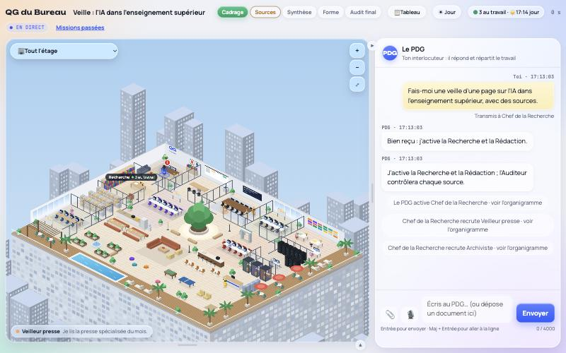

**Une petite société d'IA qui travaille pour toi, et que tu regardes travailler.**
Un PDG cadre ta demande, réveille les chefs de pôle utiles, qui recrutent leurs propres experts. Un Auditeur contrôle chaque étape : zéro invention, tout est sourcé. Tu suis la mission en direct dans le **QG**, un étage de bureaux animé sur le toit d'une tour, et tu dialogues avec le PDG.

Le Bureau fonctionne avec **Claude Code** (skill `/bureau`) ou **sans lui**, avec le modèle de ton choix : Anthropic, OpenAI, Google Gemini (offre gratuite comprise), Mistral, OpenRouter, Ollama ou Hermes. Tout tourne sur ton Mac, en Python standard et en HTML, **sans dépendance à installer**.

> Les captures ci-dessous montrent des missions de démonstration.

## Démarrage rapide

```bash
git clone https://github.com/MericV/IA_QG.git "Bureau IA"
cd "Bureau IA"
./install.sh
```

1. **Ouvrir l'app** : double-clic sur `Bureau.command`. Le serveur démarre et l'app s'ouvre sur http://127.0.0.1:8766/.
2. **Choisir un modèle** : dans « Modèles et comptes », colle une clé d'API, par exemple une clé **gratuite** Google Gemini créée sur aistudio.google.com. Elle va dans le trousseau macOS. Sinon, garde « Claude Code ».
3. **Lancer une mission** : décris-la sur l'écran d'accueil. Avec un modèle à clé, le Bureau travaille seul. Avec Claude Code, ouvre une session et tape `/bureau` (ou « mode QG »).

`install.sh` relie ce dossier à `~/.claude/skills/bureau` : Claude Code trouve alors le skill `/bureau` dans tous les projets. Prérequis : macOS (Python 3.8+, `swift`, `textutil` et `osascript` sont fournis avec le système).

## L'app

| Accueil | Le QG d'une discussion |
|---|---|
| 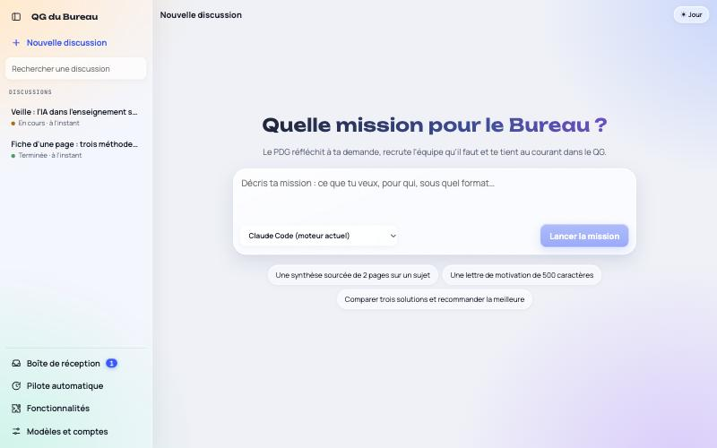 | 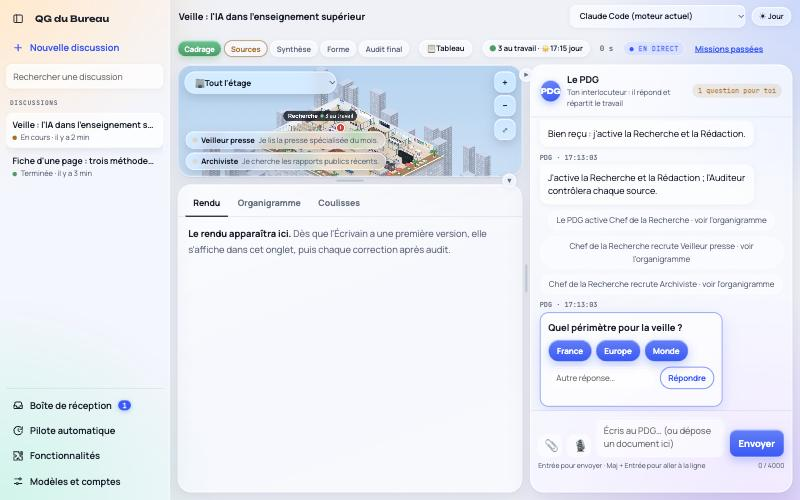 |

- **Barre latérale** : discussions, Boîte de réception, Pilote automatique, Fonctionnalités, Modèles et comptes. Elle se replie avec **Cmd + B**.
- **Verre liquide** : surfaces translucides sur un fond de couleurs douces.
- **Apparence** : le bouton en haut à droite passe de **Auto** (suit le thème clair ou sombre de l'ordinateur) à **Jour** puis à **Nuit**. L'app et le QG changent ensemble.
- **Intro** : une courte vidéo d'arrivée dans la tour, générée avec Blender (`intro/`).

## Le QG

| Jour | Nuit |
|---|---|
|  | 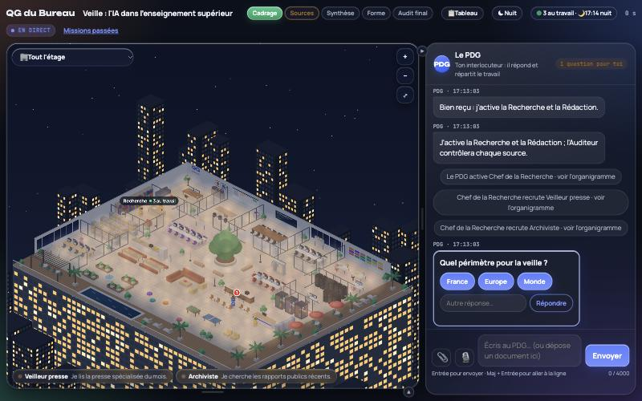 |

- **Un étage de 40 × 30 cases et 19 lieux** :
  - des salles vitrées : Direction, salle de mission, salle de conférence, Relecture, Studio design, Recherche, Archives, Atelier des experts, salle serveurs ;
  - des espaces ouverts : atrium avec un grand arbre, Rédaction, Contrôle qualité, cabines, cantine, jardin, salon, café, détente, accueil ;
  - une terrasse avec piscine.
- **La ville autour** : de jour, du ciel et des façades vitrées ; de nuit, des fenêtres allumées, des étoiles et des spots au plafond.
- **Caméra** : on arrive sur l'étage en entier. La molette ou les boutons + et − zooment, le glisser déplace la vue, ⤢ ou Échap ramène à l'étage. Le décor est préchargé autour de la vue : pas de trou quand on se déplace.

| Zoom sur une pièce | Bulle d'action sur un robot |
|---|---|
| 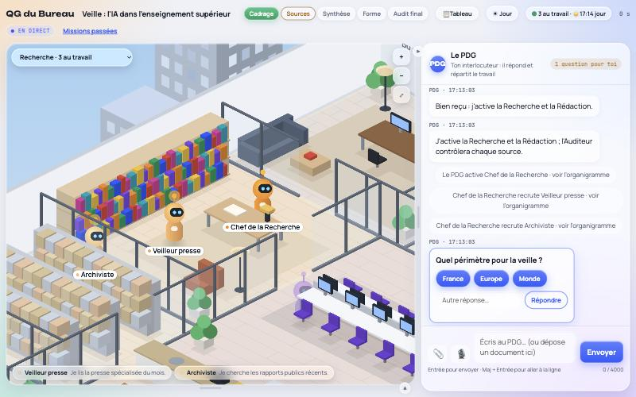 | 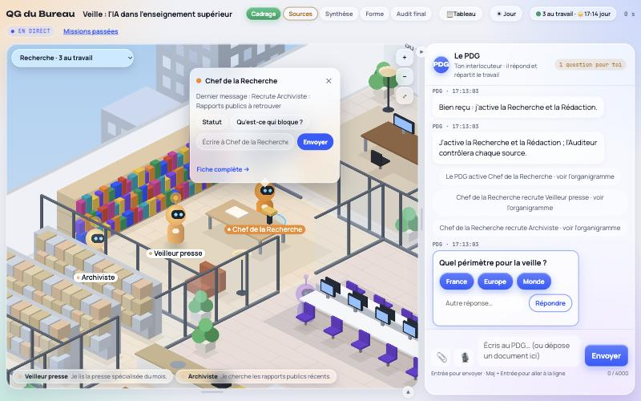 |

- **Pièces** : un clic sur une pièce, ou le menu en haut à gauche, y pose la caméra en douceur. Les noms des occupants s'affichent. Le menu donne l'état de chaque pôle (« 3 au travail », « au calme »).
- **Robots sans texte** : en vue d'ensemble, aucun nom ne cache le bureau. Celui qui parle **brille** quelques secondes, et une **pastille rouge** signale ce qui te concerne (message pour toi, question du PDG).
- **Bulle d'action** : un clic sur un robot ouvre, à côté de lui, son statut, les boutons « Statut » et « Qu'est-ce qui bloque ? » et un champ pour lui écrire (le message passe par le PDG). « Fiche complète » ouvre sa mission, son brief exact et tout ce qu'il a fait.
- **Vie du bureau** :
  - une équipe se réunit en salle de conférence quand son chef recrute ou fait la synthèse ;
  - ceux qui ont fini leur part vont au café ;
  - le PDG va à l'accueil pour te remettre le livrable ;
  - l'écran de la salle de conférence suit le livrable en cours ;
  - le tableau de mission fait pulser l'étape en cours.

## L'équipe

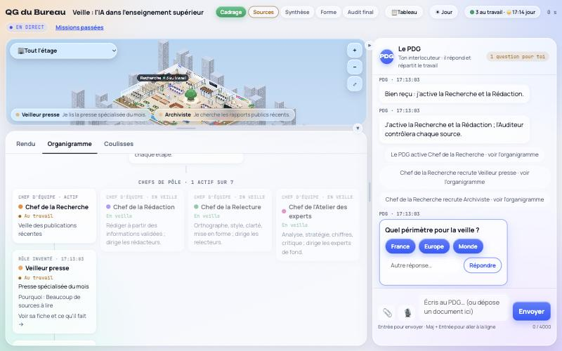

- **Deux permanents** : le **PDG** (cadre, répartit, tranche, seul interlocuteur du client) et l'**Auditeur** (contrôle chaque étape selon des règles non négociables : zéro invention, tout est sourcé, contre-vérification).
- **Sept chefs de pôle, en veille au début de chaque mission** : Recherche, Rédaction, Relecture, Atelier des experts, Conformité, Studio design et Technique. Le PDG n'active que ceux dont la mission a besoin.
- **Un chef actif dirige son équipe** : il recrute ses experts (rôles du vivier ou inventés sur mesure), qui s'installent dans son pôle. Il fait ensuite la synthèse de leur travail.
- **Circuit** : les pôles de fond travaillent en parallèle, puis la Rédaction écrit à partir de leurs travaux. La Relecture corrige la forme, l'Auditeur valide ou renvoie (deux corrections au plus) et le PDG remet le livrable.
- **Mémoire de méthode** : `lecons.md` garde ce que les missions passées ont appris ; le PDG la lit au début de chaque mission.

## Le livrable

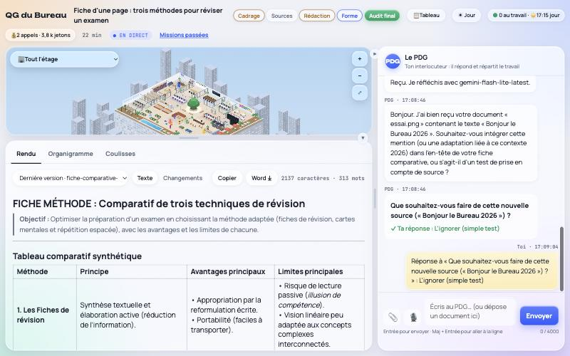

- **Rendu** : le livrable s'affiche mis en forme (titres, listes, tableaux), avec chaque version et ses changements.
- **Word ⤓** : télécharge le livrable en `.docx` avec de **vraies notes de bas de page**. Chaque citation [n] de la section Sources devient une note : la référence complète la première fois, puis « Voir note X ». Les marqueurs [HYP] et [EST] sont retirés.
- **Pièces jointes** : 📎, ou un document glissé dans la conversation (PDF, Word, RTF, PowerPoint, Excel, image, texte ; 15 Mo au plus). Son texte est extrait sur le Mac (`textutil`, PDFKit, Vision pour le texte des images) et devient une source de la mission.
- **Dictée** : 🎙️ dicte ton message avec la reconnaissance vocale du navigateur. Selon le navigateur, l'audio peut être traité par Apple ou Google.
- **Coût** : la barre du haut compte les appels au modèle et les jetons de la mission (par exemple « 💰 2 appels · 3,8 k jetons »). Le détail par modèle s'affiche au survol.

## Boîte de réception, Pilote automatique, Fonctionnalités

| Boîte de réception | Pilote automatique |
|---|---|
| 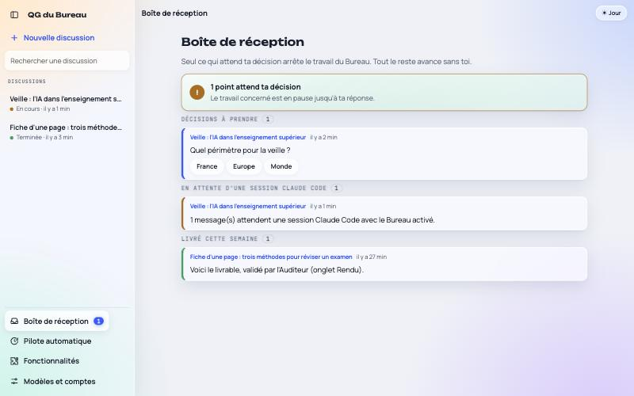 | 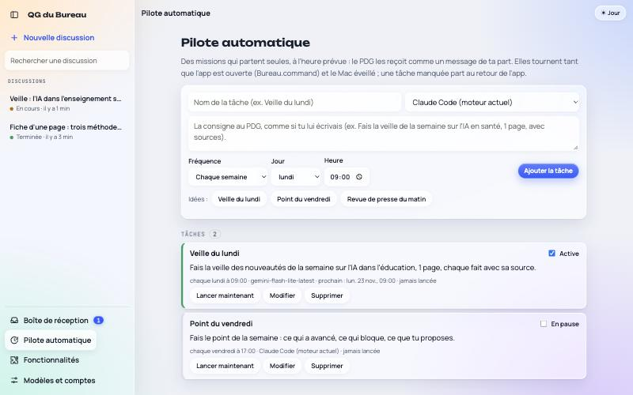 |

- **Boîte de réception** : toutes discussions confondues, elle regroupe :
  - les décisions à prendre (réponse en un clic) ;
  - ce qui est bloqué ;
  - les messages qui attendent une session Claude Code ;
  - ce qui a été livré dans la semaine.
- **Pilote automatique** : des missions récurrentes, chaque jour, chaque semaine ou toutes les N heures.
  - À l'heure prévue, le serveur envoie la consigne au PDG dans la discussion de la tâche.
  - Les tâches tournent tant que l'app est ouverte et le Mac éveillé. Une tâche manquée part une fois au retour de l'app, et une tâche en échec attend son lancement suivant.
- **Notifications du Mac** : tu es prévenu quand une mission est livrée, qu'une question t'attend ou qu'une mission s'arrête. On les désactive avec `BUREAU_NOTIF=0`.

| Fonctionnalités | Modèles et comptes |
|---|---|
| 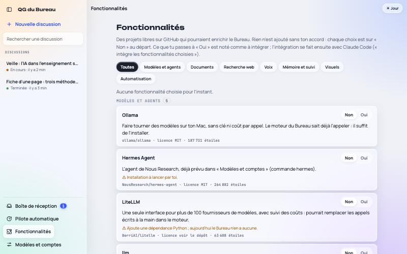 | 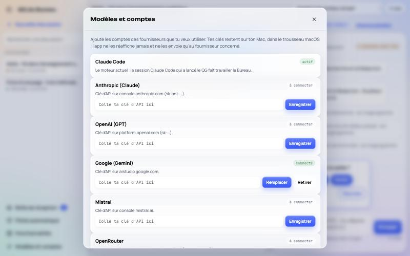 |

- **Fonctionnalités** : 22 projets libres de GitHub, vérifiés, qui pourraient enrichir le Bureau (Ollama, MarkItDown, Pandoc, SearXNG, whisper.cpp, Mermaid…). Pour chacun : ce qu'il apporterait et ses points d'attention. Tout est sur « **Non** » au départ. Ce que tu passes à « Oui » est noté à intégrer, puis intégré avec Claude Code.
- **Modèles et comptes** : les clés vont dans le trousseau macOS, ne sont jamais réaffichées et ne partent que chez le fournisseur concerné. La liste des modèles est lue chez lui.

## Moteur multi-modèles

Avec un autre modèle que Claude Code, le serveur fait travailler le Bureau seul (`moteur.py`). Le PDG (le modèle) répond, pose une question ou active des chefs de pôle (1 à 6 membres, experts compris). Tout s'affiche dans le QG comme d'habitude.

- **Recherche web** : avec Anthropic, le moteur active la recherche web et la réflexion adaptative. Les autres fournisseurs n'en ont pas, et l'offre gratuite de Gemini refuse sa recherche Google intégrée. Les règles de l'Auditeur leur interdisent d'inventer et leur font marquer « à vérifier » tout fait précis non garanti.
- **Robustesse** :
  - un fournisseur surchargé (429, 5xx) est réessayé au bout de 3, 8 puis 20 s ;
  - si un appel échoue, tu vois l'erreur et ton message est gardé pour l'essai suivant.
- **Essai réel** : une mission complète sur Gemini gratuit (`gemini-flash-lite-latest`) prend environ 100 secondes, de la demande à la remise auditée.

## Contenu du dépôt

| Fichier | Rôle |
|---|---|
| `SKILL.md` | Charte du Bureau : équipe, règles de l'Auditeur, circuit, mode QG |
| `vivier.md` · `briefs.md` · `lecons.md` | Vivier de rôles, modèles de brief, mémoire de méthode |
| `Bureau.command` | Double-clic : démarre le serveur si besoin et ouvre l'app |
| `app.html` | L'app : discussions, Boîte de réception, Pilote automatique, Fonctionnalités, Modèles et comptes, apparence, intro |
| `qg.html` | Le QG : l'étage animé, la caméra, les pièces, la conversation avec le PDG, le rendu, l'organigramme, le tableau |
| `qg_server.py` | Serveur local : discussions, comptes, pilote, boîte de réception, pièces jointes, export Word, notifications |
| `qg_log.py` | Journal de mission : échanges, équipe de base et chefs, consignes, questions, livrables, export |
| `moteur.py` | Moteur multi-modèles |
| `pieces.py` · `pdf_text.swift` · `ocr.swift` | Lecture des pièces jointes (PDF, Office, images) |
| `word.py` | Livrable Markdown → Word avec notes de bas de page |
| `audit.py` | Contrôles automatiques de l'Auditeur |
| `features.json` | Fonctionnalités proposées (le choix du client reste dans `features-choix.json`, hors dépôt) |
| `intro/` | Vidéo d'entrée dans la tour (`entree_building.py`, Blender) |
| `docs/captures/` | Captures de ce README |
| `test_*.py` | Tests (voir plus bas) |

Les données de tes missions (`projets/`, `pilote.json`, `features-choix.json`, `.token`) restent sur ton Mac et sont exclues du dépôt.

## Commandes du QG (sessions Claude Code)

Depuis la racine du projet sur lequel le Bureau travaille (`B=~/.claude/skills/bureau`).

| Commande | Effet |
|---|---|
| `python3 $B/qg_log.py init "Sujet" [nom]` | Démarre une mission, avec l'équipe de base en veille |
| `qg_log.py stages "A\|B\|C"` | Étapes de la mission |
| `qg_log.py FROM TO "texte" [type] [étape]` | Échange ; `type` = `ok`, `ko`, `deliver`, `work` ou `-` |
| `qg_log.py recruit ID "Nom" "mission" "pourquoi" ["brief"] [--equipe CHEF]` | Active un chef (ID d'un chef) ou recrute un membre, rattaché à un chef avec `--equipe` |
| `qg_log.py release ID "bilan"` · `dismiss ID "raison"` | Part terminée · fin de contrat |
| `qg_log.py livrable FICHIER [ROLE] ["libellé"]` | Nouvelle version du livrable |
| `qg_log.py ask "Question ?" "A\|B"` · `close N "raison"` | Question au client · question réglée |
| `qg_log.py ack N "…"` · `dispatch N ROLE "…"` · `applied N ROLE "…"` | Traitement du message n° N du client |
| `qg_log.py inbox` · `wait` · `wait-all` | Messages non lus ; attente d'un message (une ou toutes les discussions) |
| `BUREAU_PROJET=<nom> python3 qg_log.py …` | Agit sur une discussion de l'app, quel que soit le dossier courant |
| `qg_log.py retro` · `export` · `where` | Rétrospective · page rejouable · dossier et adresse du QG |

Outils de l'Auditeur :

```bash
python3 audit.py FICHIER.md --sources SOURCES.md --pages 5
swift pdf_text.swift FICHIER.pdf --pages 1-3
python3 pieces.py DOCUMENT       # texte d'une pièce jointe
python3 word.py LIVRABLE.md SORTIE.docx
```

## Sécurité

- Le serveur n'écoute que sur `127.0.0.1` et refuse les requêtes dont l'hôte ou l'origine n'est pas locale.
- Il ne sert qu'une liste blanche de fichiers.
- Toute écriture (message, réponse, pièce jointe, compte, tâche) exige le jeton secret de l'app. Un autre site ouvert dans le navigateur ne peut ni lire une mission ni écrire au PDG.
- Les clés d'API passent au trousseau par l'entrée standard, donc jamais en argument visible dans la liste des processus.
- Le modèle choisi et les tâches du pilote sont contrôlés, et les pièces jointes sont limitées en taille et en format.
- Les verrous du journal sont hors d'iCloud Drive, pour qu'un fichier déchargé ne bloque rien.

## Tests

```bash
python3 test_qg_log.py      # circuit complet du QG, équipe de base, sécurité du serveur
python3 test_moteur.py      # moteur multi-modèles avec un faux modèle (chefs, relecture, nouveaux essais, coût)
python3 test_pilote.py      # pilote automatique, boîte de réception, fonctionnalités
python3 test_documents.py   # pièces jointes et export Word
```

## Licence

MIT, voir `LICENSE`.
